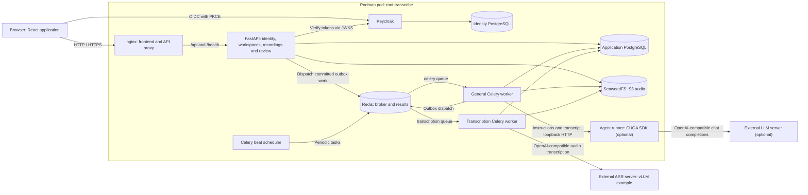
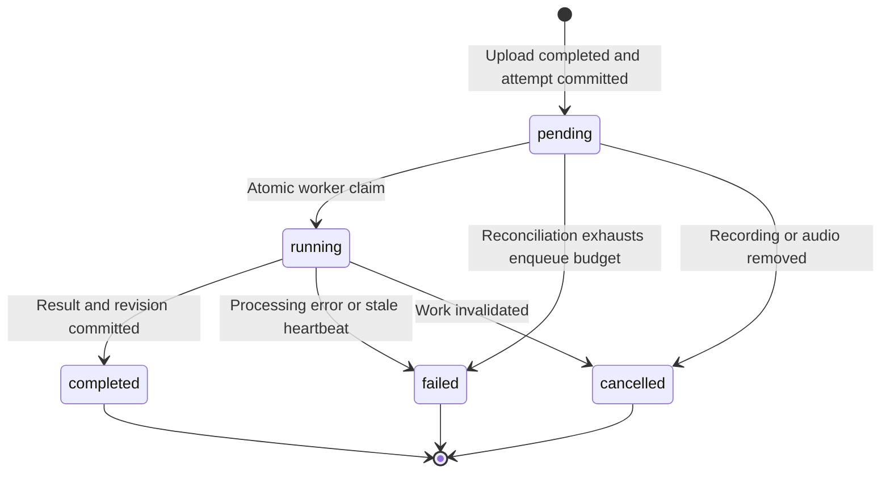

# Root Transcribe architecture

Root Transcribe records or accepts audio, separates speakers, transcribes speech,
and provides a workspace for reviewing, correcting and exporting the result.
Optionally, agents write notes (summaries, task lists) from the transcript using
a second, text model.
This document describes the implemented system. See [README.md](README.md) for
installation and operations, [backend/README.md](backend/README.md) and
[frontend/README.md](frontend/README.md) for development, and
[Nemotron.md](Nemotron.md) for a deferred model-integration study.

## Components and deployment boundaries

The local deployment uses one Podman pod, `root-transcribe`, plus an independently
managed speech-to-text server and, for meeting notes, an optional independently
managed LLM server. Containers in the pod share a network namespace
and reach each other through loopback addresses. The YAML is designed for
`podman kube play`; it is not a production Kubernetes deployment package.

| Component | Responsibility | Runtime/image |
| --- | --- | --- |
| Frontend | Capture, upload recovery, playback, transcript review, speaker directory, account and job screens | React 19, TypeScript, shadcn/ui; `root-transcribe-frontend` image |
| API | Authentication, authorization, validation, storage coordination, review and export routes | FastAPI; `root-transcribe` image |
| General worker | Outbox delivery, reconciliation, cleanup, privacy scans, data exports and meeting-note runs | Celery on `celery`; same image as API |
| Agent runner (optional) | Run one CUGA agent over a transcript and return Markdown; holds only the LLM settings | FastAPI + `cuga` SDK; `root-transcribe-agent` image, present only when `LLM_BASE_URL` is set |
| LLM server (optional) | Text model that writes the notes | External OpenAI-compatible service; not started by the app |
| Transcription worker | Audio decoding, diarization, STT calls, speaker embeddings, clips and audio redaction | Celery on `transcription`; `root-transcribe-stt` image with the `stt` Python extra |
| Scheduler | Enqueue periodic maintenance; run one instance per deployment | Celery beat; same image as API |
| ASR server | Recognize speech and return text/timestamps | External OpenAI-compatible service; optional `root-transcribe-vllm` container |
| PostgreSQL | Application records and durable work state; separate database container for Keycloak | PostgreSQL 16 |
| Redis | Celery broker/result backend and shared request-rate counters | Redis 7 |
| SeaweedFS | Original audio, retained enrollment samples, clips, redacted audio and export objects | Bundled `mini` service, version 4.52 |

The API image has no local speech or language model. The STT worker loads pyannote models
lazily and uses CUDA when visible, otherwise CPU. **The supplied app manifest does
not assign a GPU to that worker**, so it runs diarization/embeddings on CPU by
default. The separate vLLM example explicitly requests the NVIDIA GPU through CDI.

Source: [manifest](deploy/root-transcribe.yaml), [entrypoint](deploy/entrypoint.sh),
[Celery configuration](backend/app/worker/celery_app.py),
[audio/model services](backend/app/services/diarization.py).

### Meeting notes (optional)

When `LLM_BASE_URL` is set, the pod has one more container, `agent-runner`: a small
FastAPI service around the CUGA agent SDK (`agent-runner/main.py`). It listens on
the pod's loopback (port 8011, not published) and receives only the LLM settings,
so model-written code never runs next to database, storage or identity
credentials.

Flow: `POST …/recordings/{id}/notes` stores a pending `meeting_note` (with a
snapshot of the agent's instructions) and an outbox row; the general `worker`
runs `tasks.generate_meeting_note`, which renders the displayed transcript
revision as `[H:MM:SS] Speaker: text` lines, calls the runner (once, or part by
part plus a merge for long meetings, see `services/meeting_notes.py`) and stores
the Markdown. The UI polls the note list. Agents live in `note_agent` (shared when
`owner_id` is NULL, otherwise personal); exports are rendered by
`services/note_export.py`.

The runner builds a fresh agent per run, because an agent's instructions are
fixed when it is constructed. It runs one request at a time, has no tools
(transcript in, document out), and returns failures as data so the note shows a
readable reason. A fixed set of output rules (Markdown only, the meeting's
language, nothing invented) is appended to every agent's instructions at run
time and is not editable. Editing a note bumps its `version`; a save based on an
older version is refused with 409. The text the agent wrote is kept beside the
edited text so it can be restored.

Source: [runner](agent-runner/main.py), [runner image](deploy/agent.Containerfile),
[routes](backend/app/api/v1/routes/notes.py),
[note writing](backend/app/services/meeting_notes.py),
[built-in agents](backend/app/services/note_defaults.py),
[export](backend/app/services/note_export.py),
[models](backend/app/models/meeting_note.py).

### Notebooks (code name: study notes)

A learner records a tab and takes notes: a PNG of the visible frame plus the
transcript of a short piece of the tab's audio.

- **Capture (browser).** The recorder keeps the shared tab's original tracks.
  An AudioWorklet (`frontend/public/study-tap.worklet.js`) on the tab's audio
  track alone (the microphone is never connected to it) feeds a 15-second,
  sample-counted buffer at 16 kHz mono (`lib/study/tabAudio.ts`). A press pins
  the newest video frame (`ImageCapture.grabFrame`) and the look-back at the
  same moment; PNG encoding and storing happen afterwards. An open note appends
  later blocks to IndexedDB in 5-second chunks and is joined by sample
  position. Pause, resume and "Change source" start a new interval.
- **State.** `lib/study/noteController.ts` is one state machine for the Take
  note button in the recording bar and in the floating window. Presses are
  handled one at a time.
- **Floating window.** `hooks/useFloatingWindow.ts` opens a small
  always-on-top window (Document Picture-in-Picture, Chrome and Edge) and the
  provider renders `FloatingNotePanel` into it with a portal, so it shares the
  page's state. It is not part of the shared tab and never appears in a frame.
- **Local store.** IndexedDB database `study-notes` (separate from the
  recorder's). Notes are written there first and uploaded with a
  browser-made id (`PUT …/study/notes/{id}`), so retries and reloads never
  duplicate. A note left open by a crash is completed from its stored samples.
- **Server.** Tables `study_notebook` (owner + workspace + source, one per
  video), `study_session`, `study_note`. Images and
  excerpts are objects in the audio store with `audio_object` rows
  (`study_image`, `study_audio`). `tasks.transcribe_study_note` (default
  queue, no diarization) transcribes the excerpt with the recording's language
  and then requests deletion of the excerpt; a failed note keeps it for Retry
  (swept after 7 days). Deleting the recording, the notebook or the workspace
  tombstones the media.
- **Marks, thoughts, slide offers (browser).** A press can carry a mark
  (`important`, `unclear`) and a typed thought; both travel with the note
  upload (`tags`, `comment`). `lib/study/slideWatch.ts` reduces a frame to a
  32 × 18 grey picture every two seconds (clocked by the audio worklet's
  blocks, which are not slowed down in a background tab). A still picture
  replaced by another still picture is a slide change; the controller then
  holds the previous frame and the look-back audio for 20 seconds as an offer.
- **Model work on a note.** `tasks.enrich_study_note` (default queue) runs
  after the note's transcription, or at once for a screenshot. It asks the
  agent runner's `POST /chat` (one plain model call, optionally with the
  image) two questions: what can be read in the image, and a JSON answer with
  title, tidy transcript, key terms and, for `unclear`, an explanation.
  `services/study_enrich.py` checks every field; a tidy transcript whose word
  count is under 55 % or over 115 % of the original is dropped. Results are
  columns on `study_note` (`title`, `clean_text`, `slide_text`, `terms`,
  `explanation`, `enrich_status`); `text` is never changed. Off when
  `LLM_BASE_URL` is empty or the session was started with `enrich=false`.
- **Without a shared tab.** A session started with `audioOnly` takes its
  notes from the recorder's microphone stream instead of a display stream.
  The capture source then has an audio tap and no frame grabber; notes are
  uploaded without an image (`PUT …/study/notes/{id}` accepts audio alone)
  and `image_key` stays empty.
- **Questions.** A note marked `question` is captured with a 60-second
  look-back. `tasks.answer_study_question` runs after its transcription:
  (1) `POST /chat` extracts the question, search words and a first answer,
  stored at once; (2) `services/study_answer.py` searches the workspace with
  those words: segments of the display revision of recordings the notebook's
  owner may read (role and grants are evaluated in the worker; `restricted`
  recordings are excluded) and the owner's own notes; (3) if the session has
  `research_web` and `WEB_SEARCH_ENABLED` is set, the runner's
  `POST /research` runs a CUGA agent with one tool, `web_search`, and is given
  the question only; (4) `POST /chat` writes the final answer from the
  findings. Sources are stored as data (`answer_sources`): workspace excerpts
  from the search, web pages as returned by the tool, not parsed from the
  model's text. The recorder polls `GET …/study/notes/{id}` for the answer.
- **Search MCP server.** `agent-runner/search_mcp.py` (FastMCP, streamable
  HTTP on the pod's loopback, port 8012) wraps Tavily's search API behind
  `web_search`. It runs from the agent image as its own container
  (`search-mcp`), holds the Tavily key in its own secret, and is deployed only
  when both an LLM endpoint and a key are configured. At most four searches
  are allowed per question.
  Adding a second MCP server (for example RAG over documents) is described
  in `agent-runner/README.md`.
- **Wider context.** `GET …/study/notes/{id}/context?seconds=N` returns the
  segments of the linked recording's display revision around the note; it
  needs the `view_transcript` capability.
- **Own words.** `study_note.comment` holds what the owner writes on a note
  (`PATCH …/study/notes/{id}`); it is never mixed with `text`, the transcript.
- **Access.** Capability `study_notes` (editor and above). Notebooks are
  private to their owner; every route checks owner and workspace. Exporting a
  notebook that contains entries from a *restricted* recording needs the
  explicit per-user grant.

## Recording and transcription flow

Browser capture uses `MediaRecorder`. Chunks and session metadata are persisted
in IndexedDB before upload. The recording provider survives navigation and
supports recovery after a reload. Local recovery data expires after seven days.
An accepted upload does not immediately delete the local copy: the UI waits for
server-side validation and preserves rejected audio for recovery or explicit discard.

Live recordings use resumable multipart upload sessions with checksummed parts.
Picked files use a multipart form upload. Both paths go through the API to S3;
the browser does not receive S3 credentials or require direct bucket access.
Uploads are structurally checked on the client, then validated and decoded on
the worker. The worker is the authority on media validity.

```mermaid
sequenceDiagram
    participant UI as Browser
    participant API as FastAPI
    participant S3 as S3 storage
    participant DB as PostgreSQL
    participant Q as Redis / Celery
    participant W as Transcription worker
    participant ASR as ASR service
    UI->>UI: Capture and persist local chunks, or select a file
    UI->>API: Upload audio and requested language
    API->>S3: Store file or multipart parts
    API->>DB: Commit recording, attempt and outbox after upload completes
    API-->>UI: Accepted recording ID
    API->>Q: Try dispatching committed outbox task
    Note over DB,Q: General worker retries undelivered outbox entries
    Q->>W: Transcription attempt ID
    W->>DB: Atomically claim attempt
    W->>S3: Download audio to temporary file
    W->>W: Decode 16 kHz mono WAV and diarize
    W->>ASR: Full recording when under upload limit
    ASR-->>W: Text and available timestamps
    alt Genuine word timestamps available
        W->>W: Align words with speaker turns
    else No word timestamps or full file exceeds limit
        loop Each speaker turn, split into at most 30-second pieces
            W->>ASR: Transcribe audio slice with the same language choice
            ASR-->>W: Slice text
        end
    end
    W->>W: Match eligible enrolled speakers
    W->>DB: Commit transcript revision and attempt result
    UI->>API: Poll recording and revision
    API-->>UI: Speaker-attributed transcript or actionable failure
```

The full-file branch is skipped above `STT_MAX_UPLOAD_MB` (default 25 MiB).
At 16 kHz mono PCM16 this is approximately 13.7 minutes of decoded audio.
The per-turn fallback is therefore also the normal path for longer recordings.
Word alignment chooses the speaker turn with greatest overlap, or the nearest
turn when a word falls in a gap. Overlapping speech and model errors can still
require manual correction; numbered speaker labels are not verified identities.

In the per-turn path, consecutive turns of one speaker less than 0.5 s apart
are first joined (up to 30 s), so a sentence that speaker detection split is
sent in one piece. Each turn's clip then gets 0.2 s of real audio on each side
(never past the midpoint to the neighbouring turn) and 0.3 s of silence at both
ends, because a clip cut exactly at the turn's edges loses its first and last
word. A turn of at most 8 s that still comes back empty (a short reply is too
little audio for the model) is transcribed once more with 2.5 s of context on
each side; the neighbouring turns' words, already known, are matched away and
what is left is the turn. Last, when the recording was small enough for the
full-file pass, its plain text is the reference: a run of words it has and no
turn has is put back at that point of the talk, in an empty turn there or in
the neighbouring turn that has the time for it (at most five words a second).
Recordings above the upload cap have no full-file text, so this last check
does not apply to them (`services/turn_transcription.py`).

The worker streams compressed audio to disk and decodes file-to-file, but
pyannote loads the complete decoded waveform into memory. Long recordings still
need memory sizing; this is asynchronous processing after upload, not live
streaming transcription.

Source: [recording provider](frontend/src/components/recording/RecordingProvider.tsx),
[local store](frontend/src/lib/recordingStore.ts),
[upload manager](frontend/src/lib/uploadManager.ts),
[recording routes](backend/app/api/v1/routes/meetings.py),
[worker pipeline](backend/app/worker/tasks.py),
[alignment](backend/app/services/transcript_align.py).

## Language and ASR contract

Recording and upload dialogs offer **Auto / English / Swedish**. Interface
language is a separate preference and does not select the spoken language.

| Saved `requested_language` | ASR request | Behavior |
| --- | --- | --- |
| `auto` | Omit `language` | The configured ASR service detects language |
| `en` | `language="en"` | Request English transcription |
| `sv` | `language="sv"` | Request Swedish transcription |

The preference is stored with the recording and browser recovery metadata,
and reused on retries and all speaker slices. The `language` field stores the
provider's reported language independently. Existing database recordings receive
`requested_language="auto"` through migration `0002_recording_language`.
There is currently no UI to change an existing recording's saved preference.

The worker uses one configured `STT_BASE_URL`, `STT_API_KEY` and `STT_MODEL` for
all languages. There is no language-based provider routing. The client calls
`/audio/transcriptions` relative to the base URL (normally ending in `/v1`),
requests `verbose_json` and word/segment timestamps, and parses text, duration,
language and timestamps. Segment-only timestamps trigger per-turn transcription.
Language hints and timestamp accuracy depend on the chosen server/model.

Source: [ASR client](backend/app/services/transcription.py),
[recording schemas](backend/app/schemas/meeting.py),
[language migration](backend/app/alembic/versions/0002_recording_language.py).

## Durable work, retries and review

PostgreSQL holds application state; Redis is the task transport. Creating a
transcription attempt and its outbox entry in the same database transaction
prevents a committed upload from depending on a single successful broker call.
The API tries to dispatch immediately; scheduled outbox dispatch retries later.
Delivery is at least once, with database claims and uniqueness constraints to
handle duplicates. This is not an exactly-once queue guarantee.

These are **attempt states**. A recording separately exposes progress such as
`uploading`, `diarizing`, `transcribing` and `identifying`. A user retry creates a
new attempt; it does not reset the identity of the old attempt. Media faults
classified as non-retryable require a new valid upload. Only one pending/running
attempt is allowed per recording.

Each successful run creates a transcript revision with ordered, timestamped
speaker segments. Human edits have optimistic version checks and edit events.
Reprocessing attempts to carry edits forward and reports conflicts for review.
Approval supersedes the previous approved revision; only one can be approved
per recording. Review, comments, clip creation, redaction and export operate
through permission-checked APIs. Exports support Markdown, text, SRT, VTT, DOCX
and PDF; subtitle times are segment times.

Source: [attempt model](backend/app/models/meeting_transcription_attempt.py),
[outbox service](backend/app/services/task_outbox.py),
[revision model](backend/app/models/meeting_transcript_revision.py),
[export service](backend/app/services/transcript_export.py).

## Identity, permissions and speaker data

Keycloak owns login, password changes and identity roles. The browser uses OIDC
authorization code flow with PKCE S256 and keeps the Keycloak session tokens in
memory. The API validates issuer, audience and signatures using JWKS, resolves
the local user profile, and applies local account suspension. Keycloak data lives
in its own PostgreSQL volume.

Workspace roles are owner, manager, editor and viewer. Audio-specific capabilities
separately govern listening, downloading, editing, export, approval, redaction,
retention, creating notes and other operations. Overrides can target roles or individual users;
user overrides are applied after role overrides. Global administrators receive
the full base capability set. Backend checks, including sensitivity restrictions,
remain authoritative even when the UI hides unavailable actions.

Meeting notes follow the same model. Reading notes needs `view_transcript`;
creating, editing, restoring and deleting them needs `create_notes` (editors and
up); exporting needs `export`. Creating a note sends the transcript to the LLM,
so a restricted recording needs the same explicit user grant as an export.
Shared note agents are changed by administrators and power users only; a
personal agent is visible to its owner alone, administrators included.

Speaker profiles can exist without voiceprints. Enrolling a voice sample and
matching it to recordings require applicable speaker-identification consent.
The worker compares model-compatible embeddings using similarity thresholds,
a margin over the next candidate and suitable speaker turns. Uncertain matches
become suggestions for review. Naming a speaker in a transcript does not enroll
a voiceprint or establish consent.

A speaker in a transcript gets a name in one of three ways, and never without a
person deciding:

- **Typed name.** `speaker_display_name` on the segments of one detected voice
  (`POST …/assign-speaker` with `speaker_name`, or one segment via `PATCH`). It
  is an annotation on that recording: no directory entry and no voiceprint. It
  is copied when a redaction or re-transcription creates a new revision.
- **Directory person.** `speaker_profile_id`, chosen by hand or by accepting a
  voiceprint suggestion.
- **Name found in the transcript.** `POST …/speaker-names/identify` queues
  `tasks.identify_speaker_names`, which sends the transcript to the LLM through
  the agent runner with fixed instructions and stores a `speaker_name_run` with
  suggestions. Every suggestion carries the quote it rests on; the server drops
  any whose quote is not in the transcript or does not contain the name
  ([speaker_names.py](backend/app/services/speaker_names.py)). Accepting one
  writes a typed name.

The shown name is the typed name, else the directory person, else the detected
label. A typed name and a directory person replace each other; the last action
wins. All three need `relabel_speakers`; looking for names also needs the LLM to
be configured and, on a restricted recording, an explicit user grant, because
the transcript leaves the app for the LLM endpoint.

Voiceprint vectors are Fernet-encrypted in PostgreSQL. The default encryption
key derives from `SECRET_KEY`; configured named keys allow explicit rotation.
Original audio and retained samples are S3 objects: voiceprint encryption does
not imply that all stored audio is application-encrypted. Retaining raw enrollment
samples has its own consent checks. Historical consent values remain readable
and withdrawable for existing records, but new grants are limited to identification
and sample retention.

Playback uses short-lived, signed URLs issued after authorization. Range requests
stream through the API for seeking; signed playback URLs do not grant direct S3
access. The DLP service finds candidate sensitive spans using configured rules and
terms. Review and redaction are explicit operations, not a guarantee that every
sensitive item has been detected.

Retention overrides currently apply to **raw recording audio only**. Transcript
and clip retention policies are not implemented. Voiceprints use profile retention
and consent checks. Legal holds prevent applicable deletion. Audio deletion is
tracked durably and retried; metadata reports deletion only after storage confirms
it. Backups must include the database, objects and encryption keys together.

Source: [API identity dependencies](backend/app/api/deps.py),
[token verification](backend/app/core/oidc.py),
[capabilities](backend/app/core/meeting_permissions.py),
[speaker directory](backend/app/services/speaker_directory.py),
[retention](backend/app/services/retention.py),
[audio lifecycle](backend/app/models/audio_object.py).

## Persistence and configuration

The schema groups records into accounts/workspaces/membership, recordings/upload
sessions, transcription attempts/outbox/jobs, revisions/segments/edit events,
speakers/voiceprints/consent/suggestions, comments/clips/privacy/audit records,
note agents/meeting notes, and speaker-name runs.
Audio bytes live in S3; database rows hold opaque keys and lifecycle metadata.
Browser IndexedDB contains local recovery copies, independently of server storage.

Alembic migrations are explicit and ordered. `0001_transcription` initializes
an empty application database; `0002_recording_language` and
`0003_meeting_notes`, `0004_speaker_names`, `0005_study_notes`,
`0006_drop_hotkey_credential`, `0007_study_note_comment`,
`0008_study_note_enrichment` and `0009_study_question_answers` upgrade it (`0003` also inserts
the built-in note agents). Run
`alembic upgrade head` for both new installations and upgrades. Do not edit an
applied migration or change version markers to bypass an upgrade. Schema parity
and upgrade/downgrade checks are in
[the architecture tests](backend/tests/unit/test_extraction.py).

| Persistent volume / location | Contents |
| --- | --- |
| `transcribe-pgdata` | Application PostgreSQL |
| `transcribe-keycloak-pgdata` | Keycloak PostgreSQL |
| `transcribe-redis-data` | Redis persistence |
| `transcribe-seaweedfs-data` | Audio objects and SeaweedFS metadata/state |
| `transcribe-stt-hf-cache` | Downloaded diarization/embedding models |
| Host `$HOME/.local/share/root-transcribe/vllm/` | Optional vLLM model and API key |
| `deploy/secrets.local.json` and the active local manifest | Stable credentials and effective deployment configuration |

`deploy/configure.py` combines the small `settings.env` input, generated secrets,
realm import and infrastructure template. It produces private local manifests;
`root-transcribe.yaml` alone is only the infrastructure template. Prepared
manifests are edited and launched explicitly, without regeneration. Backend
runtime defaults live in [config.py](backend/app/core/config.py); advanced
settings require a custom manifest, not arbitrary additions to `settings.env`.

The API entrypoint waits for infrastructure and runs migrations. Workers and beat
wait for the migration head before starting. Bucket access is checked with the
configured credentials. The supplied SeaweedFS deployment creates the bucket.
A separately managed S3 store must already provide it.

## Ports, health and operational limits

| Service | Pod/container port | Host publication in the example |
| --- | --- | --- |
| Frontend nginx | 8080 | `127.0.0.1:8095` |
| API | 8000 | `127.0.0.1:8010` |
| Keycloak | 8185 | `127.0.0.1:8185` |
| PostgreSQL / Redis / S3 | 5432 / 6379 / 8333 | Internal only |
| General / transcription worker metrics | 9465 / 9466 | Internal only |
| Agent runner (optional) | 8011, bound to loopback | Internal only |
| Separate vLLM | 8000 in its own container | Host port 8002, all interfaces in the serving example |

The frontend proxies `/api/` and `/health` to the API. API `/health/ready` checks the
application database. Public `/api/v1/config` reports transcription availability
from configuration and a cached queue-consumer check; it does not probe live ASR
inference or prove model access. Its `notes_status` only says whether an LLM is
configured; it does not probe the runner or the model, so a failed run shows its
reason on the note. The STT worker probe checks Celery responsiveness.
Models load on first use, so an apparently healthy deployment still needs a real
audio test.

Structured logs include correlation IDs. API `/metrics` and worker metric servers
can be scraped by external monitoring. Prometheus and Loki are not bundled;
optional Loki log shipping requires a separately configured service.

Default limits include 500 MiB uploads, 120 minutes of audio, 12 MiB multipart
parts, a 24-hour upload-session lifetime, a 3,600-second ASR request timeout and a
3,600-second stale-attempt threshold. General Celery defaults are 30-minute soft
and 35-minute hard limits, but **transcription overrides them**: its soft limit
is `STT_TIMEOUT_SECONDS` (60 minutes) and its hard limit adds 300 seconds
(65 minutes). Clips, redaction, DLP scans and compliance exports have their own
shorter task limits. A meeting note allows `NOTES_TIMEOUT_SECONDS` (15 minutes)
per model run and three hours for the whole task, since a long meeting is several
runs; transcripts longer than `NOTES_MAX_INPUT_CHARS` (48,000 characters) are
split. Size task deadlines, request timeouts and stale-heartbeat
thresholds together for the actual models and recording durations.

Beat dispatches outbox work every 30 seconds and reconciles transcription attempts
every 120 seconds. It also schedules audio deletion, expired-upload cleanup and
job/audio retention. See the code for retry budgets and UTC schedules.

The bundled Keycloak `start-dev`, single-host storage and loopback publications
are intended for local use. Remote browser recording requires HTTPS and correct
public frontend/identity origins. Production needs an appropriate identity,
TLS, backup and service-management setup. The scripts do not install automatic
host-boot startup. See the README's lifecycle commands before recreating containers:
a plain container restart does not apply a new image or changed environment.
